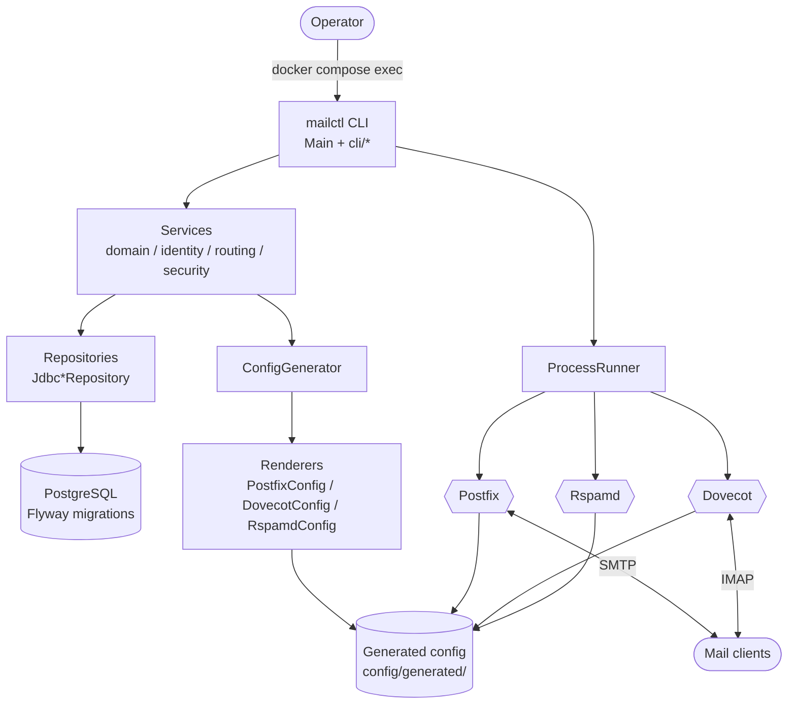
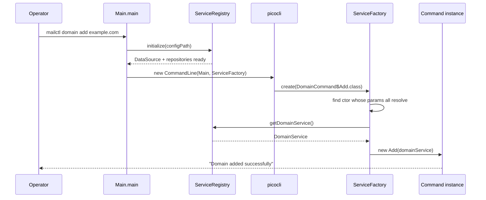
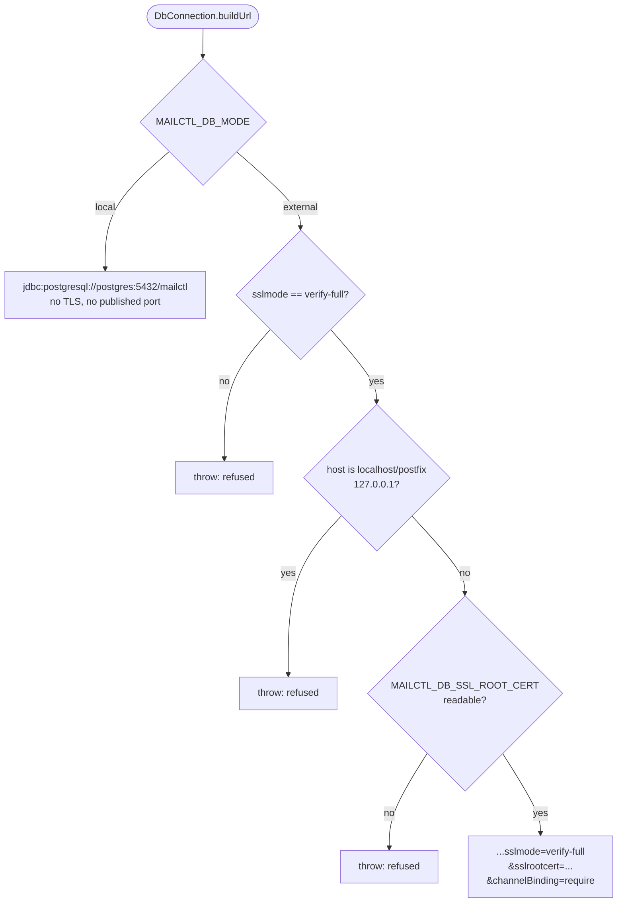
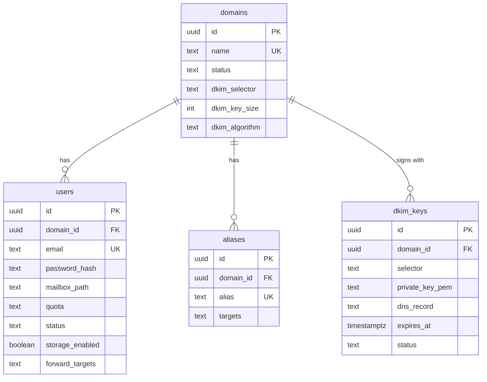

# Architecture

mailctl is a **control plane**. It never speaks SMTP or IMAP and never accepts
mail. It stores state in PostgreSQL and renders configuration files; Postfix,
Dovecot and Rspamd do the protocol work.

That split is the central design decision. Reimplementing an MTA is a trap, so
Java holds the things that are genuinely yours — who may receive mail, which
domains exist, which key signs outbound mail — and delegates wire protocols to
mature software.

## System shape

The dotted path is the seam that matters: **mailctl writes files, the services
read them.** Under Docker these are bind-mounted directories, which is why
`scripts/apply-config.sh` copies generated files into the service mount points
and restarts the containers.

## Layers

| Layer | Packages | Responsibility |
|-------|----------|----------------|
| Entry | `Main`, `cli/` | Parse arguments, inject dependencies, print results |
| Domain | `domain/`, `identity/`, `routing/`, `security/` | Business rules: valid domain names, DKIM key lifecycle |
| Persistence | `*Repository`, `infrastructure/DatabaseConfig` | JDBC access, migrations, connection policy |
| Rendering | `mail/`, `infrastructure/ConfigGenerator` | Turn database state into service configuration |
| Operations | `infrastructure/HealthChecker`, `ProcessRunner`, `FileManager` | Diagnostics and controlled external commands |

Dependencies point downward only: `cli` → services → repositories. Nothing in
`domain/` knows that picocli exists.

## Dependency injection

picocli instantiates subcommands itself and will choose a **no-arg
constructor**. Every command class therefore has two constructors — one taking
its services, one setting them to `null`. Left alone, picocli picks the no-arg
one and every command prints `Service not initialized` while exiting 0.

`Main.ServiceFactory` implements `CommandLine.IFactory` and prefers the
constructor whose parameters it can *all* resolve from `ServiceRegistry`:

Two details matter:

1. `initialize()` runs **before** `execute()`. picocli builds subcommands lazily
   during execution, so registering the services in the parent command's
   `run()` would be too late.
2. Several commands take **two** services (`doctor run` needs a `HealthChecker`
   and a `ProcessRunner`). The factory scores every constructor and only accepts
   one whose parameters all resolve, otherwise it would silently fall back to the
   no-arg constructor for exactly those commands.

`--help` and `--version` skip initialization entirely — they are what you run
when something is already broken.

## Database connection policy

`DbConnection` owns the local/external decision and refuses to let external mode
be downgraded.

The same three refusals exist in `scripts/start.sh` and
`scripts/docker-entrypoint.sh`, so a downgrade cannot be introduced through any
entry point — including a bare `java -jar`.

## Configuration generation

`ConfigGenerator.generateAll` reads the database and writes:

| Output | Consumed by |
|--------|-------------|
| `main.cf`, `virtual_*_maps` | Postfix |
| `dovecot.conf`, `dovecot-sql.conf.ext` | Dovecot |
| `dkim_signing.conf`, `options.conf`, `dkim_*.map` | Rspamd |
| `dkim/<selector>.private` | Rspamd signing |

Every renderer writes a `DO NOT EDIT DIRECTLY` header, because the files are
regenerated from the database on every run and a hand-edit is lost on the next
change.

Files are installed with `FileManager.atomicReplace` (write to `.new`, then
`ATOMIC_MOVE`) so a service reading the directory never sees a half-written
file.

## Data model

Schema is owned by Flyway in `src/main/resources/db/migration`. The column names
there are load-bearing: the JDBC repositories read them by name, so renaming one
breaks the runtime rather than the build.

## Runtime container layout

| Path | Source | Purpose |
|------|--------|---------|
| `/app/mailctl.jar` | image | shaded CLI jar |
| `/etc/mailctl/config.yaml` | `./config` | optional file config |
| `/etc/mailctl/generated/` | `./config` | rendered service configuration |
| `/etc/mailctl/pki/` | container (writable) | staged client key at 0600 |
| `/etc/mailctl/keys/` | `./keys` (read-only) | TLS material for external mode |
| `/var/mail` | `mail_data` volume | maildirs shared with Postfix and Dovecot |
| `/var/backups/mailctl` | `./backups` | backup output |

The `pki/` split exists because PgJDBC refuses a group- or world-readable private
key, and `keys/` is mounted `0444`.

## Known limitations

- **`service reload` cannot work under Docker.** `ProcessRunner` shells out to
  `postfix`, `doveadm` and `rspamadm`, which are absent from the mailctl image,
  and reloading a sibling container needs `docker exec`. Use
  `scripts/apply-config.sh`, which restarts the containers instead.
- **`doctor` reports unperformed checks as passing.** See
  [cli-reference.md](cli-reference.md#doctor) — treat a green result as "nothing
  errored", not "everything verified".
- **`backup create`/`restore` do not write an archive yet.**
- **The Rspamd milter address is `rspamd`, not `localhost`.** Postfix and Rspamd
  are separate containers. The generated `main.cf` now emits
  `inet:rspamd:11332` on both `smtpd_milters` and `non_smtpd_milters`; override
  with `MAILCTL_RSPAMD_HOST` / `MAILCTL_RSPAMD_MILTER_PORT`. `non_smtpd_milters`
  is the one that applies DKIM/SPF/DMARC checks to inbound mail, which a
  forwarding setup depends on.
- **Forwarding-only users are rewritten, not delivered.** They appear in
  `virtual_alias_maps` and never in `virtual_mailbox_maps`, and the Dovecot
  `userdb` query filters on `storage_enabled` while the `passdb` query does not —
  so they can send but cannot read.
